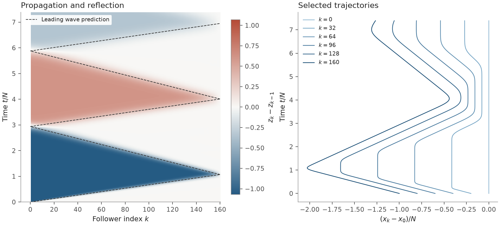

# pyflock

Numerical simulation and spectral analysis of one-dimensional arrays of assymetrically coupled
linear oscillators. The package includes reproducible demonstrations from the
Cantos–Hammond–Veerman paper corpus, next-nearest-neighbour studies, and Lyons's
heterogeneous-agent thesis. The [coverage map](docs/coverage.md) identifies source
figures, adaptations and constructed comparisons.



## Run the demos

Python 3.12 was used for the checked environment. From the repository root:

```sh
python -m venv .venv
. .venv/bin/activate
python -m pip install -r requirements-tested.txt
python -m pip install -e . --no-deps
python -m pyflock.experiments all
python -m pytest
```

Each demo saves PDF, SVG and PNG figures, numerical arrays, and a JSON record of
parameters, sources, software versions and checksums under `figures/`. To run
one demo, or redraw its saved arrays:

```sh
python -m pyflock.experiments reflection
python -m pyflock.experiments reflection --redraw
```

The [gallery](docs/gallery.md) and [expanded gallery](docs/gallery-expanded.md)
explain the figures. The default profile uses smaller demonstrations;
`--profile paper` uses the sizes recorded in the coverage map. For example:

```sh
python -m pyflock.experiments convergence --profile paper --jobs 4 --output figures-paper
python -m pyflock.experiments nnn-types --profile paper --output figures-expanded
python -m pyflock.experiments lyons_response --profile paper --jobs 2 --output figures-expanded
```

The convergence paper profile has 30 parameter pairs, two boundaries and six
sizes through 3,200 followers. The larger studies checkpoint and resume matching
results; reduce `--jobs` to limit CPU use. `nnn-ensemble --profile paper` runs
24,000 cases in new restricted stable families; the original configurations
were unavailable.

## Use the package

With offsets $j=-2,\ldots,2$,

$$\ddot z_k=g_x\sum_j\rho_{x,j}z_{k+j}+g_v\sum_j\rho_{v,j}\dot z_{k+j}.$$

Each stencil sums to zero. On a path, $N$ counts the followers; agent $0$ is the
leader. Periodic systems use $N$ total agents. The heterogeneous module follows
Lyons's convention: $N$ total agents and positive gain magnitudes with an overall
minus sign.

```python
import pyflock as pf

st = pf.nn_stencil(-1, -1, alpha_x1=-0.5, alpha_v1=-0.3)
res = pf.simulate_line(st, N=160, tmax=1000, nt=1601, bc="regular")
print(pf.signal_velocities(st))
print(pf.transient_summary(res.t, res.last_relative))
```

[Model and conventions](docs/model.md) defines boundaries and observables.
[Sources](docs/sources.md) lists the works used by the demos.
[Numerical notes](docs/numerical-notes.md) records coefficient corrections and
precision limits. Tests compare independent Fourier, matrix and ODE methods;
source records distinguish numerical sensitivity from asymptotic error.

## References

- C. E. Cantos, J. J. P. Veerman, and D. K. Hammond.
  [*Signal velocity in oscillator arrays*](https://doi.org/10.1140/epjst/e2016-02665-0).
  European Physical Journal Special Topics **225**, 1115–1126 (2016).
- C. E. Cantos, D. K. Hammond, and J. J. P. Veerman.
  [*Transients in the synchronization of asymmetrically coupled oscillator arrays*](https://doi.org/10.1140/epjst/e2016-02658-y).
  European Physical Journal Special Topics **225**, 1199–1209 (2016).
- J. Herbrych, A. G. Chazirakis, N. Christakis, and J. J. P. Veerman.
  [*Dynamics of locally coupled agents with next nearest neighbor interaction*](https://doi.org/10.1007/s12591-017-0377-3).
  Differential Equations and Dynamical Systems **29**, 487–509 (2021; online 2017).
- F. M. Tangerman, J. J. P. Veerman, and B. D. Stošić.
  [*Asymmetric decentralized flocks*](https://doi.org/10.1109/TAC.2012.2199150).
  IEEE Transactions on Automatic Control **57**(11), 2844–2853 (2012).
- J. J. P. Veerman.
  [*Symmetry and stability of homogeneous flocks (a position paper)*](https://pdxscholar.library.pdx.edu/mth_fac/131/).
  Portland State University working paper (2010).
- R. G. Lyons.
  [*Linear Nearest Neighbor Flocks With All Distinct Agents*](https://pdxscholar.library.pdx.edu/open_access_etds/5903/).
  PhD dissertation, Portland State University (2022).
- I. Herman, S. Knorn, and A. Ahlén.
  [*Disturbance scaling in bidirectional vehicle platoons with different asymmetry in position and velocity coupling*](https://doi.org/10.1016/j.automatica.2017.04.010).
  Automatica **82**, 13–20 (2017).
