# Expanded experiments

Each name below runs through `python -m pyflock.experiments NAME --profile paper
--output figures-expanded`. Add `--redraw` to use saved arrays. The source record
states the parameters, measurements, numerical checks, and departures from the
paper. See [coverage](coverage.md) and [source corrections](numerical-notes.md).

## Published nearest-neighbour examples

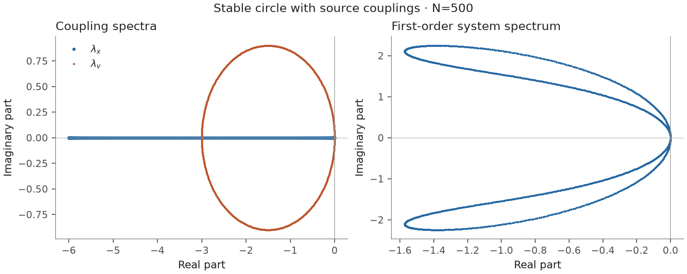

`nn_stable_spectra`: the published 500-agent stable example, showing the coupling
symbols and the resulting second-order dynamics as a first-order system.

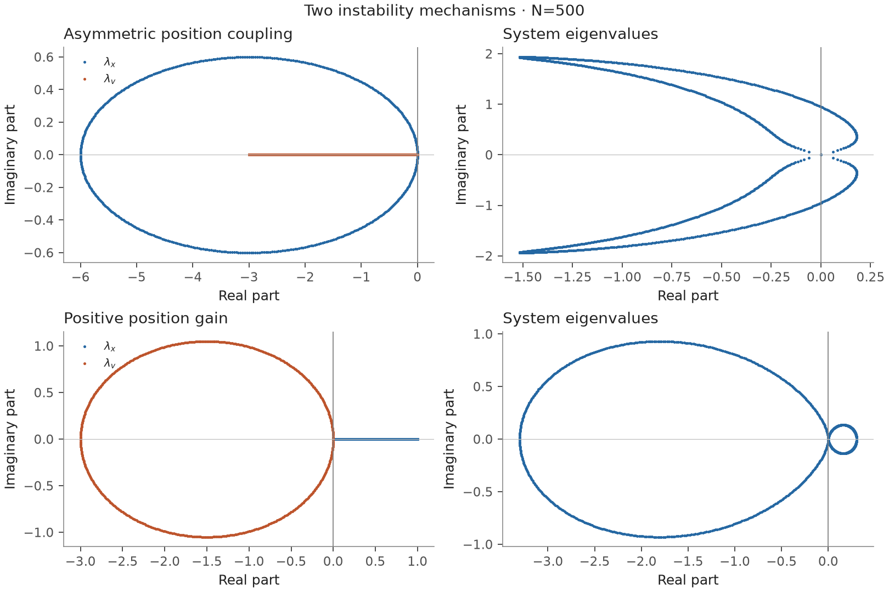

`nn_instability`: asymmetric position feedback and positive position gain produce
the two published instability mechanisms. Eigenvalues in the right half-plane
remain visible on separate axes.

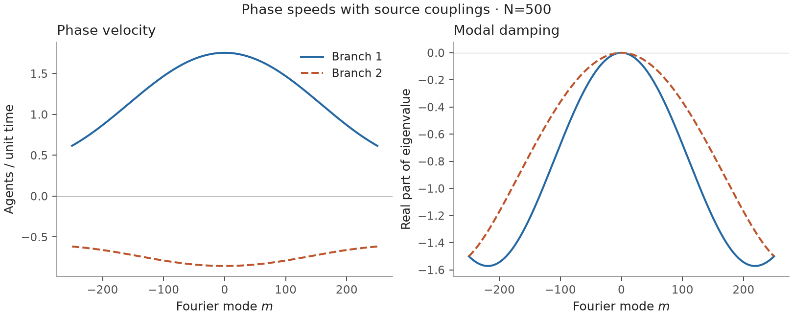

`nn_phase_speeds`: phase velocity and damping have separate axes and units.
The zero-mode phase speed is its analytic limit.

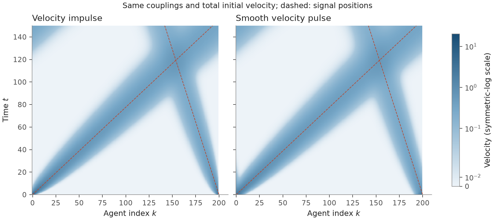

`nn_pulse_comparison`: the 200-agent velocity impulse from *Signal velocity*,
Figure 3(b), and a smooth pulse under identical couplings and equal total initial
velocity. Both use the same
colour normalization; the impulse lies outside the theorem's regularity hypotheses.

## NNN waves and convergence

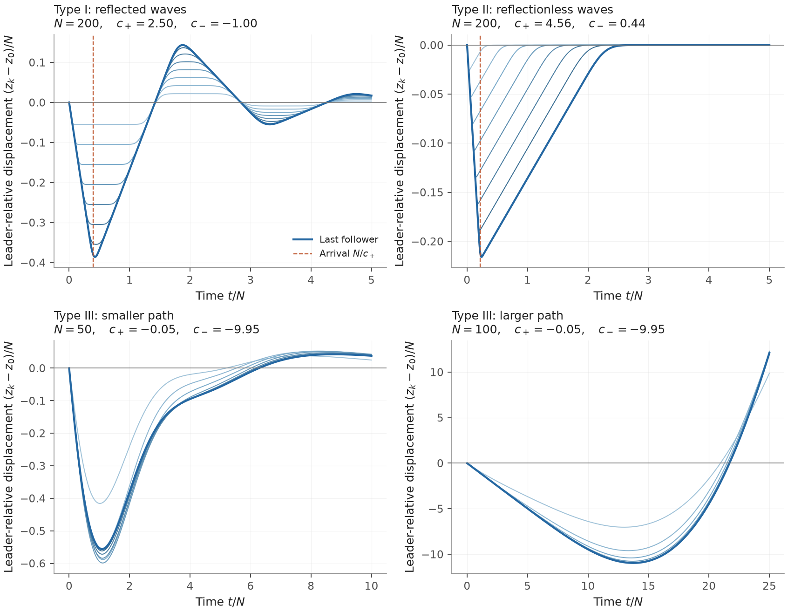

`nnn-types`: the published Type I and II systems with 200 followers, and Type III
with 50 and 100. Type II exhibits a single excursion without repeated reflection.
Type III uses the documented sign correction to the printed coefficients.

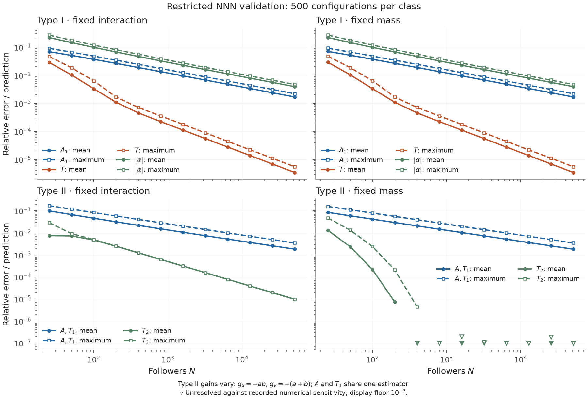

`nnn-ensemble`: a new deterministic study of 500 configurations per class, both
physical boundaries, and twelve sizes through 51,200 followers. These restricted
families have an all-size path stability argument. Type II gains vary; the paper's
configurations and selection rule were unavailable. Complete coefficient arrays
are saved.
Prediction-guided measurement windows and the Type II identity $T_1=A/v_0$ are
explicit: the amplitude and first-response error curves coincide by construction.
Downward triangles mark unresolved errors at a display sensitivity level, rather
than at their raw values. The level combines saved coarsening, trace and contour
changes with a $10^{-7}$ floor; it is a diagnostic convention, not a certified bound.

## Transfer roots, spectra and amplification

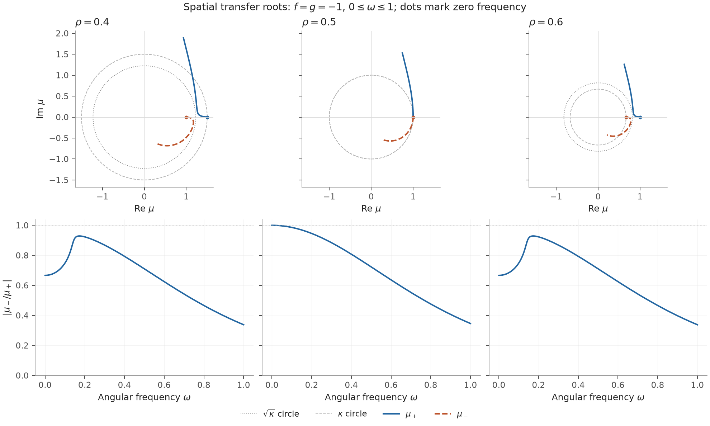

`matched_transfer_roots`: the published gains and three coupling asymmetries,
with both spatial roots over a stated frequency interval. Dots mark zero
frequency; the second row shows the modulus ratio.

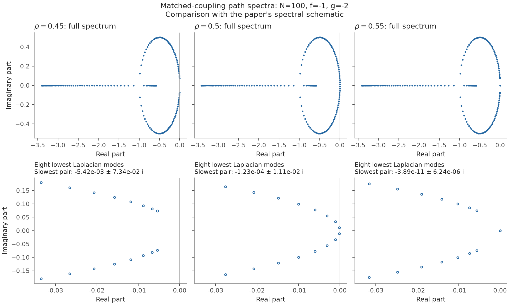

`matched_spectra`: finite-path eigenvalues accompany the schematic in *Symmetry
and stability*, Figure 4. The lower panels share scales and state the slowest
pair explicitly; the smallest mode requires high precision. A spectral gap alone does not determine
transient amplification.

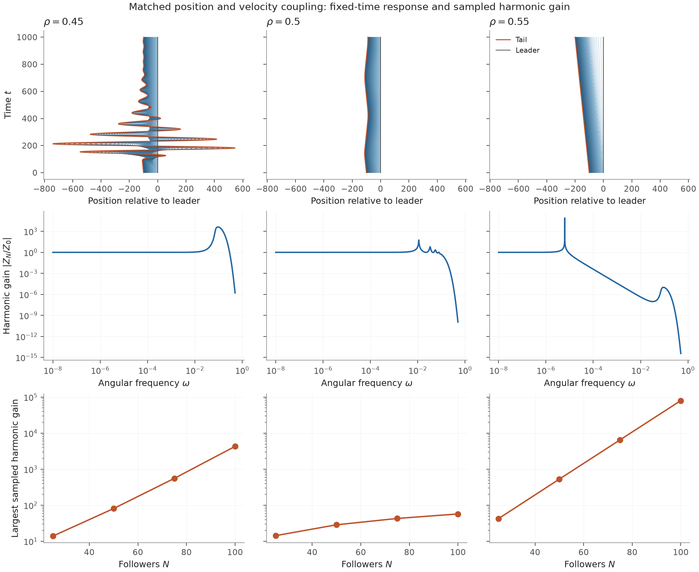

`matched_amplification`: the $\rho=.45,.50,.55$ trajectory comparison, harmonic
leader-to-tail gain, and its dependence on size. All three trajectory panels share
scales and the finite time window. Narrow resonances use high precision; the
reported maxima are refined samples over a saved band, not certified norms.

## Heterogeneous agents

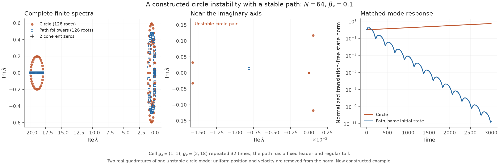

`lyons_stability_reversal`: a new repeated-cell example of the reversal reported
in Lyons's Figures 12–14. There are 64 agents, $g_x=1$, alternating
$g_v=2,18$, and $\beta_v=.1$. Full finite spectra give an unstable circle pair
with real part $5.62\times10^{-4}$, while the follower path has spectral abscissa
$-8.13\times10^{-3}$. A positive Lyapunov matrix independently checks path stability.
The complete cell and selection rule are recorded; these are constructed gains.
The full spectrum uses a broken real axis: the distant negative cluster occupies
a narrow panel, leaving space to distinguish the right-hand eigenvalues.
The response uses the same saved complex initial state on both graphs, interpreted
as two real quadratures. Its norm removes uniform displacement and velocity and
is normalized to one initially.

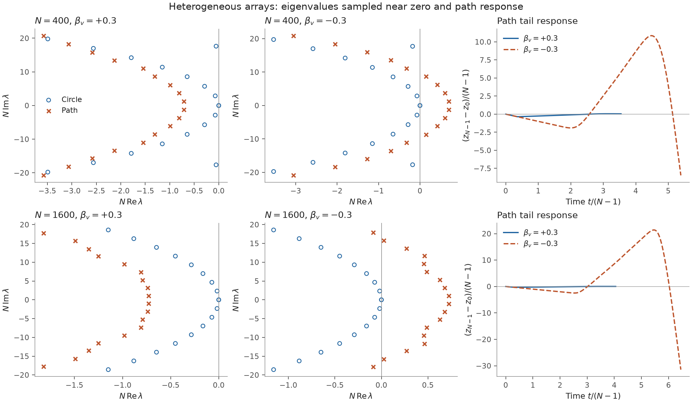

`lyons_boundary`: fixed saved gain samples at 400 and 1,600 total agents, paired
between circle and path and between velocity-asymmetry signs. The spectra sample
the origin; they do not establish full spectral stability. Position gains follow
$U(1,5)$; velocity gains follow $U(3,13)$ at 400 agents and $U(2,18)$ at 1,600.
Each response window
is recorded; the positive-asymmetry trace can end before the growing negative one.
The gain arrays used in the thesis were unavailable; these samples were not
chosen for an outcome.

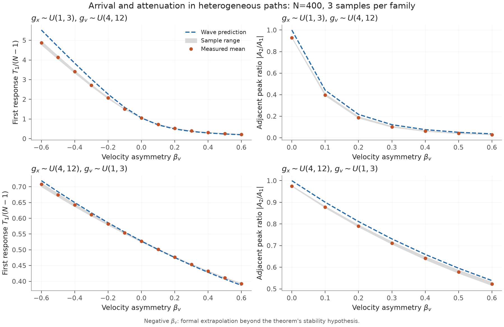

`lyons_response`: the two thesis gain distributions, three saved samples per
family, and velocity-asymmetry sweeps. Shading shows the sample range. For negative
asymmetry the wave formula is a formal extrapolation outside the stability
hypothesis. Sampling sensitivity is recorded separately from sample variation.

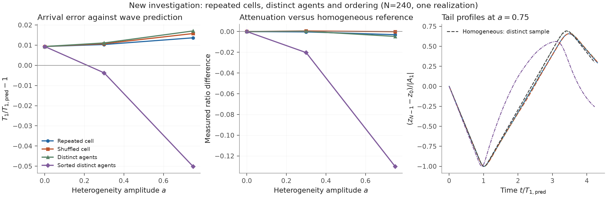

`lyons_ordering`: a new controlled comparison of repeated cells, distinct agents,
and their orderings as heterogeneity increases. This is one realization, not an
ensemble conclusion. Gains are $g_x=2(1+a u_x)$, $g_v=1.5(1+a u_v)$ with saved
$u_x,u_v\sim U(-1,1)$ and $\beta_v=.2$. Equivalent homogeneous references use
$g_x=1/M$, $g_v=V/M$, where $M=\langle1/g_x\rangle$ and
$V=\langle g_v/g_x\rangle$.

## Force input and a continuum comparison

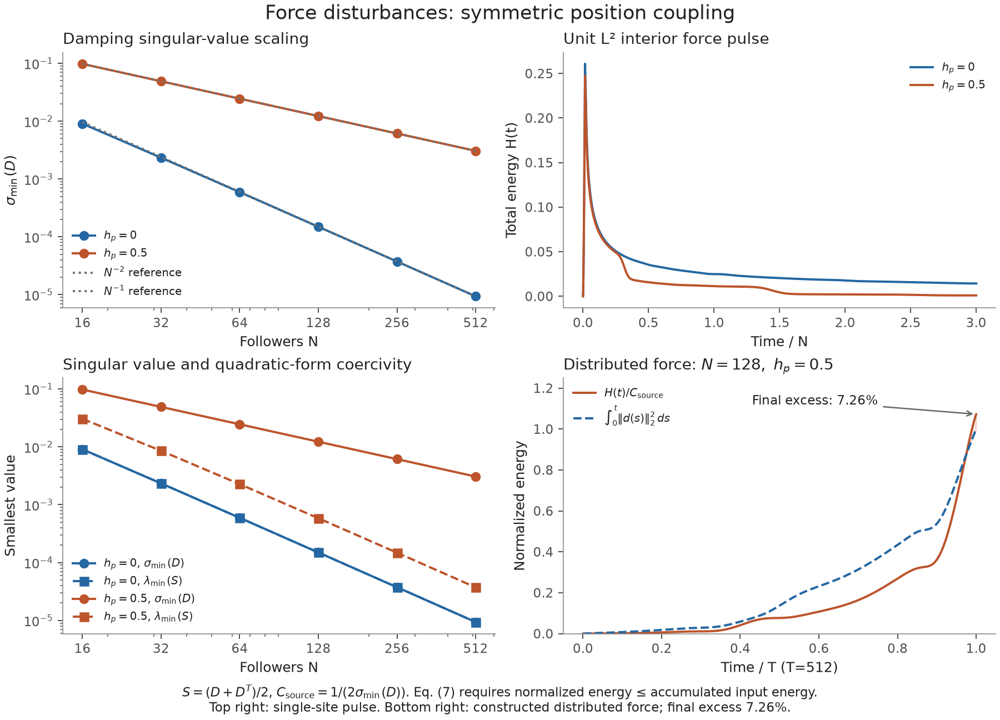

`energy`: damping singular values, a unit-$L^2$ interior-force response, and total
kinetic-plus-spacing energy. A constructed distributed force gives a final energy
7.26% above the source's equation (7) bound. Independent integration checks this
numerical comparison; see [Numerical notes](numerical-notes.md).

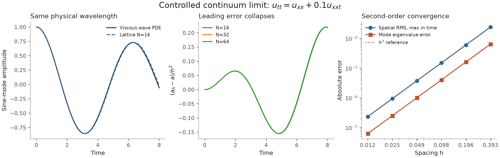

`continuum`: a symmetric periodic lattice at fixed physical wavelength converges
to $u_{tt}=u_{xx}+0.1u_{xxt}$. Exact mode evolution isolates spatial error and
exhibits second-order convergence. This is a controlled specialization of Lyons's
heuristic continuum discussion.
