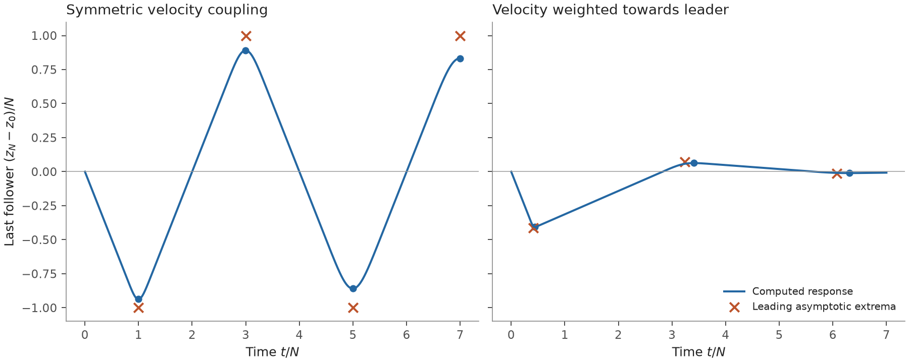
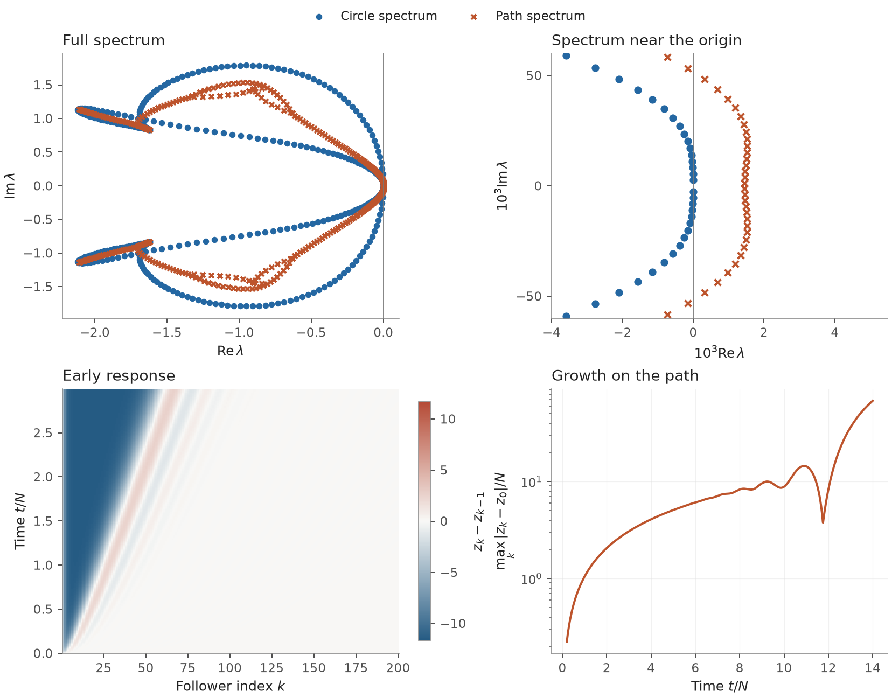
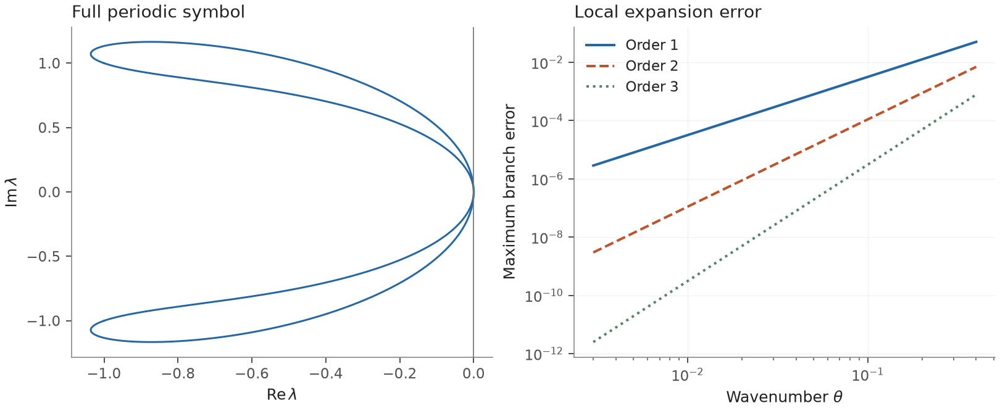
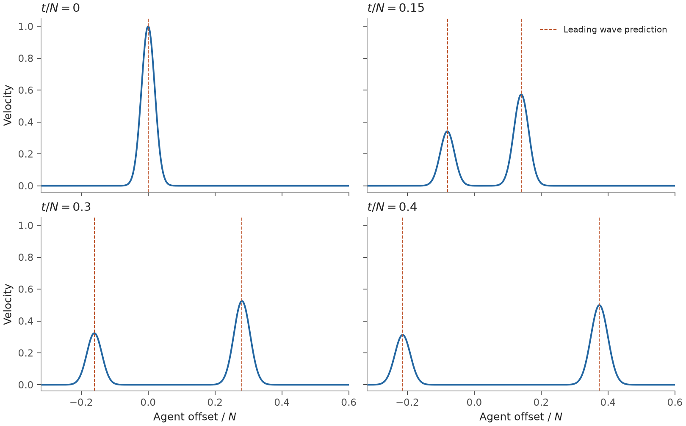
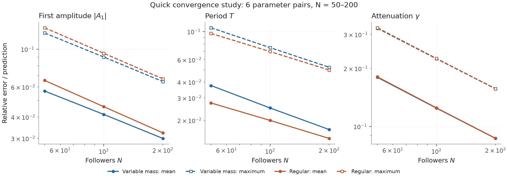
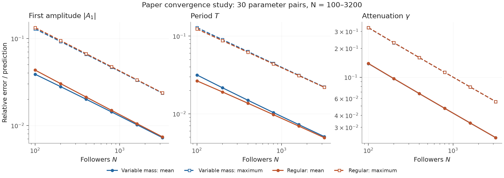

# Experiment gallery

Run `python -m pyflock.experiments all` from the repository root. Each experiment
writes `data.npz`, `experiment.json` and `figure.{pdf,svg,png}` into its own folder.
The JSON record contains the complete stencils, initialization, boundary rule,
source reference, software versions and checksums. The figures below are checked
previews; they can be regenerated with the same commands.

These are selected demonstrations and adapted comparisons. The
[coverage map](coverage.md) lists the corresponding published experiments and
the major omissions.

## Propagation and reflection

`propagation`: 160 followers, $g_x=g_v=-1$, symmetric position weights,
$\rho_{v,1}=-0.3$, regular boundary. The leader starts at velocity one.
The left panel shows spacing deviations; the right shows six physical trajectories
relative to the leader. Dashed rays use the leading signal speeds. Both panels
share the time scale $t/N$. The reflected rays use the conditional path description
in *Transients*; they are an asymptotic comparison.

## Velocity asymmetry

`reflection`: the parameter comparison from *Transients*, Figure 3, here with
160 followers and $g_x=g_v=-2$. Position coupling is symmetric; velocity weights
$\rho_{v,1}=-1/2$ and $0$ appear on the same vertical scale. The second case has a
smaller first excursion and stronger attenuation. Small blue dots mark measured extrema; open diamonds mark leading predicted
extrema. The predictions are discrete points. The hypotheses and conjectural
step are described in [Model and conventions](model.md).

## Circle and path can disagree

`boundary`: the historical circle-stable/path-unstable NNN example, with
80 followers and the `drop` boundary. A separate panel resolves eigenvalues near zero.
The lower-left panel shows the early spacing field; the lower-right shows the maximum
leader-relative displacement over agents, on a logarithmic scale. Separating the
time windows keeps late growth from obscuring the early response. This is a direct
finite-system computation, with no reflected-amplitude overlay. The sensitivity
estimate for the rightmost path eigenvalue is recorded in the JSON.

## Local spectral expansion

`dispersion`: the propagation stencil's full periodic symbol, alongside the
maximum error over its two branches for three expansion orders. The coefficients
are obtained analytically from the stencil moments. The error panel uses only
small wavenumbers; local approximations do not set the full-spectrum axis limits.

## A smooth periodic pulse

`pulse`: 1,024 agents, zero initial displacement and a periodic Gaussian velocity
pulse of width $N/50$. All four profiles use the same axes. Dashed marks give the
two leading signal positions. The interval ends before either pulse reaches the
periodic plotting seam. This is a smooth-pulse illustration; the point impulse
shown historically has different regularity assumptions.

## Errors across a parameter family

`convergence`: relative errors in the first amplitude, full period and attenuation
$A_3/A_1$, using the **predicted value** as denominator. Solid curves show means,
dashed curves maxima over the parameter family. The quick profile has six pairs
and $N=50,100,200$; the paper profile has the published 30 pairs and
$N=100,200,400,800,1600,3200$, for each boundary. The quick preview is a demonstration,
not the complete historical experiment.

The CSV retains every measurement; the NPZ retains each tail trace for independent
re-extraction. Extrema are refined by a local parabola. The period estimator is
the time between the first and third extrema; the source averages same-sign
intervals, so this is a comparison on its published grid rather than an exact
reproduction of its measurement procedure.
The time grid uses at least 2,401 samples and resolves the estimated first-arrival
width with eight intervals. Runs reject cases whose coarsening change exceeds
`max(1e-4, 0.05 × asymptotic error)` in prediction-normalized units.
The JSON reports changes when every second time sample is discarded; this checks
sampling sensitivity separately from the asymptotic errors being plotted.

### Published parameter grid

The completed 360-case run uses the paper profile. At $N=3200$, averaging over
both boundaries and all parameter pairs gives relative errors of 0.73% in the
first amplitude, 0.50% in the first full period, and 2.34% in attenuation.
The largest coarsening change over all cases is below $4\times10^{-5}$ in
prediction-normalized units. These are numerical comparisons with the conditional
asymptotic formulas; no fitted convergence rate is asserted.

## Redraw and validation

`--redraw` checks the saved data checksum and renders from arrays without running
simulations. The computation and rendering source digests are recorded separately. Each
experiment also retains the package source in `source/`, matching its computation
digest; redraw validates this snapshot when present.
A changed renderer can therefore be used without losing the provenance of the data.

Tests compare Fourier and matrix calculations, dense and sparse propagation,
Runge–Kutta and matrix exponentials, and analytic special cases. They also check
expansion residuals, invalid approximation regimes and the saved-data redraw path.
PNG previews and PDF renderings are inspected for labels, scales, clipping and
whether each comparison remains understandable at its intended size.
